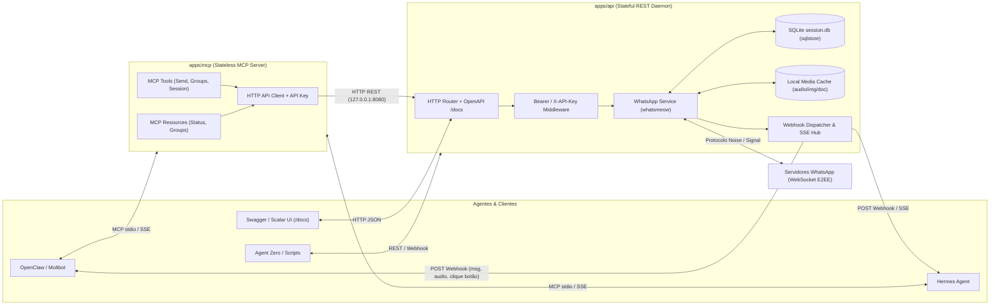
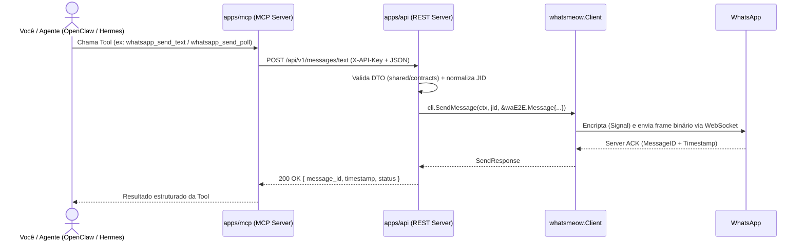
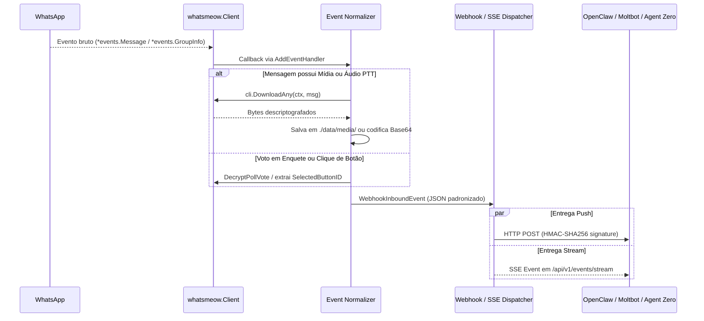

# Arquitetura do Sistema — `gabe-whats`

O `gabe-whats` segue uma **arquitetura desacoplada em dois processos**, separando o **Daemon da API REST (`apps/api`)** do **Servidor MCP (`apps/mcp`)**, conectados por **contratos compartilhados (`shared/contracts`)**.

---

## 1. Por que separar a API REST (`apps/api`) do Servidor MCP (`apps/mcp`)?

1. **Estado vs. Stateless:**
   - `apps/api` é **stateful**: precisa ficar rodando continuamente em background para manter o WebSocket aberto com os servidores do WhatsApp, segurar o lock exclusivo do `session.db` (SQLite do `whatsmeow`), receber eventos em tempo real e disparar Webhooks.
   - `apps/mcp` é **stateless**: frameworks de agentes como **OpenClaw**, **Moltbot**, **Hermes Agent**, **Agent Zero** ou clientes IDE normalmente iniciam e encerram o servidor MCP sob demanda via **`stdio`** (ou conectam via SSE). Se o `whatsmeow` morasse dentro do processo `stdio` do MCP, cada agente que abrisse o MCP derrubaria a conexão do WhatsApp ou corromperia o SQLite por concorrência.
2. **Múltiplos Consumidores Simultâneos:**
   - Com a API REST rodando em `http://127.0.0.1:8080`, você pode conectar ao mesmo tempo:
     - O **Servidor MCP** para o seu OpenClaw / Hermes / Agent Zero chamar ferramentas (`tools`);
     - **Webhooks HTTP POST** ou **SSE** entregando mensagens recebidas para o agente;
     - Chamadas diretas via `curl`, Postman, Swagger UI (`/docs`), scripts pessoais ou n8n.

---

## 2. Diagrama Geral de Componentes



---

## 3. Fluxos Principais

### 3.1 Fluxo de Envio (Agente $\rightarrow$ WhatsApp via MCP)



### 3.2 Fluxo de Recebimento (WhatsApp $\rightarrow$ Agente via Webhook / SSE)



---

## 4. Estrutura de Pastas do Workspace

```text
gabe-whats/
├── README.md                          # Visão geral e índice do projeto
├── .env.example                       # Variáveis de ambiente (API + MCP + Webhook)
├── go.work.example                    # Modelo de Go Workspace ligando shared, api e mcp
├── docs/
│   ├── 01-WHATSMEOW-RESEARCH.md       # Estudo técnico do repositório tulir/whatsmeow
│   ├── 02-ARCHITECTURE.md             # Este documento (arquitetura e diagramas)
│   ├── 03-API-SPEC-SWAGGER.md         # Guia da API REST e documentação automática (/docs)
│   ├── 04-MCP-AND-AGENTS.md           # Guia do Servidor MCP e integração OpenClaw/Hermes
│   └── openapi.yaml                   # Especificação OpenAPI 3.1 completa da API REST
├── shared/
│   └── contracts/                     # Contratos Go (DTOs JSON) compartilhados entre API e MCP
│       ├── README.md
│       ├── messages.go
│       ├── groups.go
│       └── webhooks.go
├── apps/
│   ├── api/                           # Daemon REST stateful (porta 8080) + whatsmeow + SQLite
│   │   ├── README.md
│   │   ├── cmd/server/main.go
│   │   └── internal/
│   │       ├── config/
│   │       ├── whatsapp/blueprint.go
│   │       ├── http/router.go
│   │       ├── http/handlers/
│   │       ├── http/middleware/
│   │       └── webhook/
│   └── mcp/                           # Servidor MCP stateless (stdio / SSE) para agentes
│       ├── README.md
│       ├── mcp-config.example.json
│       ├── cmd/mcp-server/main.go
│       └── internal/
│           ├── apiclient/
│           ├── tools/blueprint.go
│           └── resources/
```

---

## 5. Princípios de Design Aplicados

- **Separação estrita de responsabilidades:** O `apps/mcp` **nunca** importa `go.mau.fi/whatsmeow` nem abre o arquivo `.db` do SQLite. Ele conversa exclusivamente com o `apps/api` via HTTP utilizando os tipos de `shared/contracts`.
- **Segurança local por padrão:** A API REST escuta em `127.0.0.1:8080` com autenticação via `X-API-Key` / `Authorization: Bearer`. Webhooks enviados aos agentes levam assinatura HMAC opcional (`X-GabeWhats-Signature`).
- **Auto-documentação (Code-First OpenAPI):** Todos os DTOs em `shared/contracts` possuem tags de validação, exemplos e descrições para que a biblioteca HTTP/OpenAPI gere `/docs` e `/openapi.json` automaticamente sem drift entre código e documentação.
